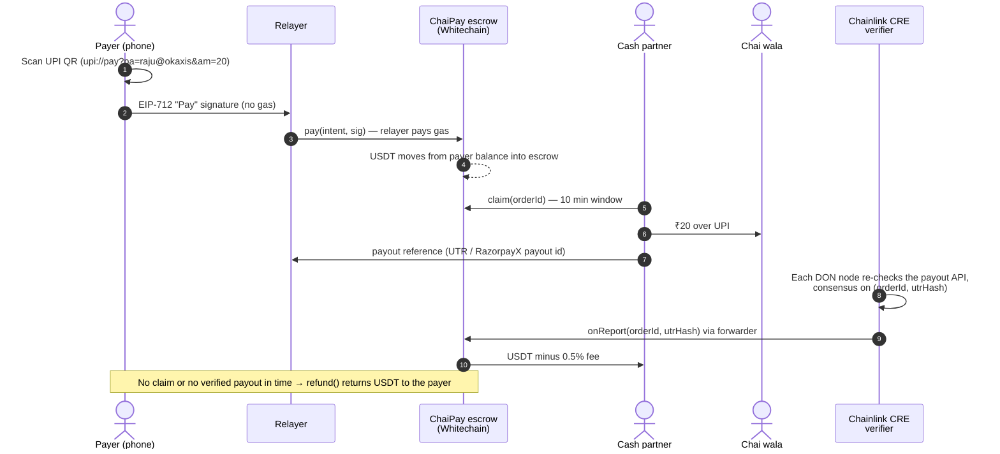

# ChaiPay

**Scan any UPI QR. Pay in USDT. The chai wala gets rupees.**

India has 600M+ UPI users and every tea stall has a QR on the counter. People holding stablecoins
still can't buy a ₹20 chai with them. ChaiPay lets you scan the same UPI QR everyone already uses,
approve the payment on your phone with no gas and no seed phrase, and the shop receives rupees in
their bank like any other UPI payment. They don't need to know crypto exists.

Built at ETHGlobal Mumbai 2026 for **Whitechain · Scale: Payments Nobody Notices** and
**Chainlink · Best workflow with CRE**.

## Why this needs onchain stablecoin settlement on Whitechain

A regular payment rail can't let a stranger hold your money, pay a merchant on your behalf and get
paid back without a custodian in the middle. ChaiPay's escrow does exactly that: your USDT can only
move to a cash partner after an independently verified UPI payout, or back to you on timeout, and
Whitechain's cheap fast blocks plus a sponsored relayer make that viable for a ₹20 payment.

## How it works



| Part | Path | What it does |
|---|---|---|
| Escrow contract | [`contracts/src/ChaiPay.sol`](contracts/src/ChaiPay.sol) | Internal USDT balances, EIP-712 pay/withdraw intents (EOA + ERC-1271), LP claims, CRE `onReport` receiver, refunds |
| Relayer | [`relayer/src/index.js`](relayer/src/index.js) | Submits signed intents and pays gas; quotes INR→USDT; LP API; refund sweeper |
| Phone app | [`app/`](app/) | Device wallet, QR scanner, confirm, live receipt, cash partner dashboard |
| CRE workflow | [`cre/chaipay-verifier/`](cre/chaipay-verifier/) | Independently verifies UPI payouts and writes a DON-signed report |

### Payer sees zero crypto steps

- **No gas.** The payer signs an EIP-712 intent; the relayer submits it. Tested: the payer wallet's
  native balance is 0 before and after paying (`test_payer_never_needs_gas`, and the e2e demo).
- **No seed phrase.** A device wallet is created on first open. Contract signature checks use
  `SignatureChecker`, so an ERC-1271 smart account / embedded wallet works the same way.
- **No chain choice.** The payer only ever sees rupees.
- **Gasless even if the token has no `permit`.** Users top up once (`depositFor` lets an exchange or
  friend fund them); every payment after that is just a signature.

### How the business pays for gas, and what stops a drain

- Each fulfilled order sends a **0.5% fee** (hard-capped at 1% in the contract) to the relayer
  operator. Swapping that USDT for WBT keeps the relayer funded. A **₹10 minimum order** keeps the
  fee above the gas cost.
- The relayer **simulates every transaction first**, so a request that would revert costs nothing.
- It only ever calls ChaiPay, through a fixed function list.
- **Rate limits** per payer and per IP, a **gas price cap**, and a **low-balance alert**.
- It **rejects stale or inflated quotes**, so a buggy client can't overpay.
- The contract has a **per-order cap** that bounds the damage from a leaked signature.
- The relayer **can't move funds**: it can't change an amount or payee (signature-bound,
  `test_relayer_cannot_change_amount`) and can't replay (`test_replay_reverts`).

### Why the cash partner can't steal, and the payer can't get stuck

- USDT is released to the partner only when the verifier role confirms the UPI payout.
- If no partner claims within 15 minutes, or the partner misses the 10-minute window, **anyone** can
  call `refund()`. The relayer sweeps these automatically.

## Run it locally (about 2 minutes)

Requires [Foundry](https://getfoundry.sh) and Node 20+.

```bash
# 1. Contracts + tests
cd contracts && forge test            # 22 tests incl. a fuzz test

# 2. Local chain + deploy (in another terminal: anvil --chain-id 1874)
#    see scripts/e2e-demo.mjs for the full flow it exercises

# 3. Relayer + app
cd ../relayer && npm install && cp .env.example .env   # fill in RPC_URL, CHAIPAY_ADDRESS, keys
npm test && npm start                                  # http://localhost:8787 serves the app too

# 4. CRE workflow tests (uses Chainlink's own test runtime)
cd ../cre/chaipay-verifier && bun install && bun test
```

## Deploy to Whitechain Sepolia (chain 1874)

```bash
cd contracts
export RPC_URL=<your Ankr Whitechain testnet RPC>
export PRIVATE_KEY=<deployer key with test WBT>
export LP=<cash partner address> FEE_RECIPIENT=<relayer address> VERIFIER=<verifier address>
forge script script/Deploy.s.sol --rpc-url $RPC_URL --broadcast
# then verify on the Whitechain explorer (see docs.whitechain.io for the verifier URL)
```

Fund a payer: `scripts/fund-payer.sh <payer-address> 5`. The app shows the address under **Add money**.

To test the camera on a phone you need HTTPS (browsers block cameras on plain http except
localhost). A tunnel such as `cloudflared tunnel --url http://localhost:8787` works.

## Deployed

| | |
|---|---|
| ChaiPay contract (verified) | [0x3DB25D9ee7dB7FD250d80637677ADf5f5753d419](https://explorer.testnet.whitechain.io/address/0x3DB25D9ee7dB7FD250d80637677ADf5f5753d419) |
| First USDT payment settled in the main flow | [fulfill tx](https://explorer.testnet.whitechain.io/tx/0xbe1a880d4033c0d28a987d23a94bb9a64a96693ea0be4fd2be11440933578d2f) |
| Relayer (pays all gas) | 0x9e37329a85Ac8498DDEEeE55f8798356D84C4C09 |
| Cash partner (LP) | 0x38880afe54eb4597Ac934C4E2634F4672a7fC653 |

## Chainlink CRE

The workflow ([`verifier.ts`](cre/chaipay-verifier/verifier.ts)) runs every 30s:

1. Reads the relayer's queue of claimed orders whose partner reported a payout. It treats the queue
   as a hint, not as truth.
2. On every DON node, looks the payout up at the provider (RazorpayX Payouts) and checks it is
   processed, mode UPI, the right amount and the right VPA.
3. Reaches consensus on `(orderId, utrHash)` with `ConsensusAggregationByFields`.
4. Produces a signed report and calls `writeReport` → forwarder → `ChaiPay.onReport`.

Run `bun test` in `cre/chaipay-verifier` for 6 tests on Chainlink's test runtime. These cover a
valid payout, wrong amount, wrong UPI ID, a payout that's not processed, an empty queue, and
attested mode. On a machine with the CRE CLI:

```bash
cd cre && cre workflow simulate chaipay-verifier --target staging-settings
```

## Current limitations (honest list)

- **Whitechain isn't a CRE network yet.** CRE simulation targets Ethereum Sepolia. On Whitechain, the
  `verifier` role is held by an oracle key running the same check, through `fulfill()`. Pointing
  `verifier` at a KeystoneForwarder needs no contract change once Whitechain is supported.
- **Stage demo uses LP-attested UTRs.** Paying from a phone UPI app gives a UTR that no public API
  can confirm, so the demo trusts the allowlisted partner's attestation (`PAYOUT_PROVIDER=mock`,
  `verificationMode: attested`). The RazorpayX path verifies independently and is what production
  would use.
- **Fixed INR rate** from config (`INR_PER_USDT`). Production needs a price feed and partner bidding.
- **Partners are allowlisted by the owner.** Next steps: partner bonds, and World ID so each partner
  is a verified unique human.
- **Device wallet** lives in browser storage. Clearing site data loses it, so keep balances small.
  Swapping in an embedded smart-account provider needs no contract change (ERC-1271).
- **Regulation.** Crypto-to-UPI flows in India touch RBI/NPCI rules and crypto tax (30% + 1% TDS).
  This is a prototype, not a licensed payment service.

## How AI was used

Built with Claude (Anthropic) as a pair programmer for the contract, tests, relayer, app and CRE
workflow, per ETHGlobal's rules. Every component was run and tested locally, with the logs and
screenshots in the repo history.

## License

MIT
